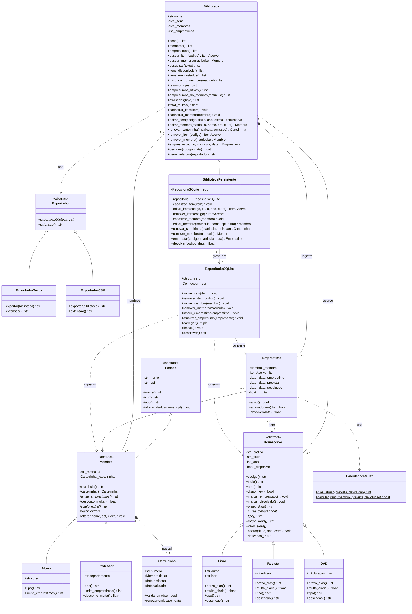
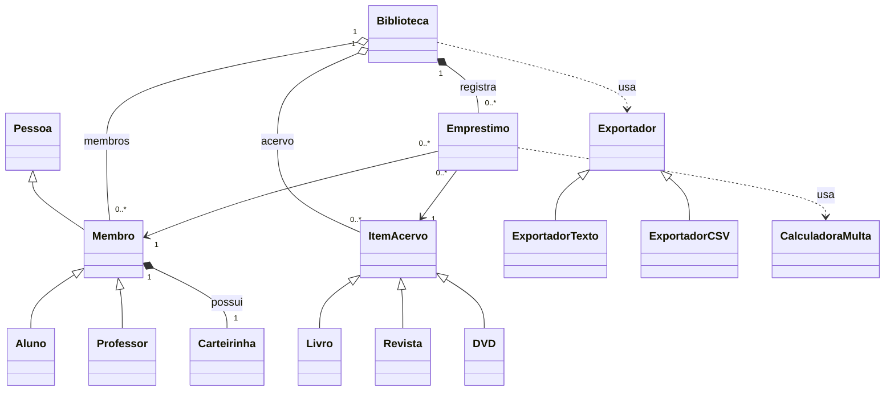

# 📚 Sistema de Biblioteca

Projeto acadêmico de **Programação Orientada a Objetos** das disciplinas **Desk App I**, **Desk App II** e **Desk App III**.

**Autor:** Vinicius

Aplicação desktop em **Python 3.10+ com Tkinter e banco de dados SQLite** para gerenciar o acervo (livros, revistas e DVDs), os membros (alunos e professores), empréstimos, devoluções com multa e relatórios. O projeto demonstra **Herança, Polimorfismo, Composição, Agregação, Associação e Dependência**, todas cobertas por testes automatizados.

## 🆕 Desk App III — banco de dados

Nesta etapa os dados passaram a ser gravados num **banco de dados SQLite** (arquivo `biblioteca.db`, criado na pasta do projeto). O SQLite já vem com o Python, então **não é preciso instalar nada**. Cada cadastro, edição, remoção, renovação, empréstimo e devolução é gravado **na hora**; ao fechar e abrir o programa, tudo volta como estava.

| Tabela | O que guarda |
|---|---|
| `itens` | Livro, Revista e DVD numa tabela só (coluna `tipo`), cada um com sua coluna extra (`autor`/`isbn`, `edicao`, `duracao_min`) |
| `membros` | Aluno e Professor (coluna `tipo`, com `curso` ou `departamento`) e os dados da carteirinha (número, emissão, validade) |
| `emprestimos` | Item, membro, datas, devolução e multa — com **chaves estrangeiras** para `itens` e `membros` |

Como funciona no código:

- **`biblioteca/repositorio.py`** — `RepositorioSQLite`: a única classe que conhece SQL. Cria as tabelas, faz `INSERT`/`UPDATE` (upsert) e lê tudo de volta como objetos (`Livro`, `Aluno`, `Emprestimo`…).
- **`biblioteca/persistente.py`** — `BibliotecaPersistente` **herda** de `Biblioteca`: cada método chama o da classe-mãe com `super()` (onde estão as regras de negócio) e, se deu certo, grava no banco. Se a regra falhar, nada é gravado.
- **Remoção sem perder histórico:** item e membro removidos ficam com `ativo = 0`, assim os empréstimos antigos e as multas continuam no banco.
- **Disponibilidade** do item não é gravada: ela é calculada pelos empréstimos em aberto.
- Na **primeira execução** o banco é criado com os dados de exemplo. **Arquivo ▸ Nova biblioteca** apaga tudo do banco; **Arquivo ▸ Carregar dados de exemplo** recomeça com os exemplos; **Arquivo ▸ Ver banco de dados** mostra o conteúdo das tabelas.
- No terminal: `python3 ver_banco.py` imprime as três tabelas. Para usar outro arquivo: `python3 app.py outro.db`.

## Desk App II — menu completo

Nesta etapa o sistema ganhou uma **barra de menu totalmente funcional**, que dá acesso a **todos os modelos** (Livro, Revista, DVD, Aluno, Professor, Carteirinha, Empréstimo e Exportadores) e a **todas as funcionalidades**. (No Desk App II os dados ficavam só em memória; o banco veio no Desk App III.)

| Menu | Itens |
|---|---|
| **Arquivo** | Nova biblioteca (vazia) · Carregar dados de exemplo · Ver banco de dados · Sair (`Ctrl+Q`) |
| **Cadastros ▸ Acervo** | Novo Livro (`Ctrl+L`) · Nova Revista · Novo DVD · Editar item · Remover item |
| **Cadastros ▸ Membros** | Novo Aluno (`Ctrl+M`) · Novo Professor · Editar membro · Remover membro · Renovar carteirinha |
| **Movimentação** | Emprestar item (`Ctrl+E`) · Devolver item (`Ctrl+D`) |
| **Consultas** | Acervo completo · Itens disponíveis · Itens emprestados · Pesquisar no acervo (`Ctrl+F`) · Membros · Carteirinhas · Empréstimos ativos · Atrasados · Histórico · Empréstimos de um membro |
| **Relatórios** | Relatório em Texto (`Ctrl+R`) · Relatório em CSV · Salvar relatório (`Ctrl+S`) · Resumo geral |
| **Exibir** | Ir para as abas Acervo, Membros, Empréstimos e Relatório (`Ctrl+1` a `Ctrl+4`) |
| **Ajuda** | Regras de negócio (`F1`) · Atalhos de teclado · Sobre |

O que mudou no código:

- **`dialogos.py`** (novo): `FormularioDialog` (formulário genérico usado em cadastro, edição, remoção, empréstimo, devolução, renovação e pesquisa), `JanelaLista` (consultas) e `JanelaTexto` (ajuda/resumo). Nos formulários, **Enter** confirma e **Esc** fecha; se der erro de regra de negócio, a janela continua aberta para corrigir.
- **Edição** de itens e membros (`Biblioteca.editar_item` / `editar_membro`). O formulário de edição usa **polimorfismo**: `rotulo_extra()` e `valor_extra()` fazem o campo virar *Autor*, *Edição*, *Duração*, *Curso* ou *Departamento* conforme o objeto. Código, matrícula e carteirinha não mudam.
- **Renovação de carteirinha** (`Carteirinha.renovar` / `Biblioteca.renovar_carteirinha`): mesma carteirinha (composição), nova validade de 365 dias.
- Novas consultas: `itens_emprestados()`, `historico_do_membro()` e `resumo()` (usado na barra de status).
- Abas ganharam botão **Editar selecionado** e duplo clique na tabela abre a edição. Os diálogos do menu já vêm com o item/membro selecionado na aba.

## ▶️ Como executar

Requisitos: Python 3.10 ou superior (o Tkinter já vem com o Python; no Ubuntu/Debian, se faltar: `sudo apt install python3-tk`).

```bash
git clone https://github.com/VinyCrz/sistema-biblioteca.git
cd sistema-biblioteca
python3 app.py
```

Na primeira vez é criado o banco `biblioteca.db` com dados de exemplo (4 itens e 2 membros). Das próximas vezes, o sistema abre com os dados que foram salvos.

Para ver o banco pelo terminal:

```bash
python3 ver_banco.py
```

## 🧪 Como rodar os testes

```bash
python3 -m pip install -r requirements.txt
python3 -m pytest -v
```

Em um Linux sem interface gráfica, use `xvfb-run -a python3 -m pytest -v` (sem display, os testes da interface são pulados automaticamente).

**Resultado atual: 128 testes, 100% passando.**

| Arquivo de teste | O que verifica |
|---|---|
| `test_heranca_polimorfismo.py` | `isinstance`/`issubclass`, classes abstratas, prazos/multas/tipos, `descricao()` sobrescrita, limites e descontos, exportadores, validações |
| `test_relacoes.py` | Uma seção para cada relação: composição, agregação, associação e dependência (com `unittest.mock.patch`) |
| `test_funcionalidades.py` | Cadastros, buscas, remoções, pesquisa, empréstimos, limites, devoluções, multas, atrasados, carteirinha vencida, relatórios |
| `test_interface.py` | A tela Tkinter: cadastros, erros, pesquisa, empréstimo/devolução com multa, filtro de atrasados, data inválida, relatórios |
| `test_edicao.py` | (Desk App II) Edição de cada tipo de item e membro, validações sem alterar o objeto, renovação de carteirinha, histórico, resumo |
| `test_banco.py` | (Desk App III) Grava, fecha e reabre o banco: cadastros de cada tipo, carteirinha, edição, empréstimo/devolução com multa, regras depois de reabrir, remoção sem perder histórico, erro que não grava, chave estrangeira |
| `test_menu.py` | (Desk App II e III) Aciona **todas** as entradas do menu e verifica que nenhuma quebra; cadastro/edição/remoção/empréstimo/devolução/consultas/relatórios pelos diálogos |

## ✅ Funcionalidades

| Aba | Funcionalidade |
|---|---|
| Acervo | Cadastrar Livro, Revista ou DVD (o campo extra muda: Autor / Edição / Duração) |
| Acervo | Remover item selecionado |
| Acervo | Pesquisar por título, autor ou tipo (filtra enquanto digita) |
| Membros | Cadastrar Aluno ou Professor (Curso / Departamento) com carteirinha automática |
| Membros | Remover membro e ver empréstimos ativos (X/Y) |
| Empréstimos | Emprestar e devolver informando a data (vazio = hoje) |
| Empréstimos | Cálculo de multa na devolução e filtro "Mostrar só atrasados" |
| Relatório | Gerar relatório em Texto ou CSV e salvar em arquivo |
| Menu (Desk App II) | Tudo acima pelo menu, mais: editar item/membro, renovar carteirinha, consultas filtradas, histórico por membro, resumo geral, ajuda |

## 📏 Regras de negócio

| Tipo | Prazo | Multa por dia de atraso |
|---|---|---|
| Livro | 14 dias | R$ 1,00 |
| Revista | 7 dias | R$ 0,50 |
| DVD | 3 dias | R$ 2,00 |

| Membro | Limite de empréstimos simultâneos | Desconto na multa |
|---|---|---|
| Aluno | 3 | — |
| Professor | 10 | 50% |

- **Multa** = dias de atraso × multa diária do item × (1 − desconto do membro).
- A **carteirinha** é criada junto com o membro (`CART-0001`, `CART-0002`…) e vale **365 dias**; com ela vencida não é possível emprestar.
- **Bloqueios:** não é possível emprestar item já emprestado, passar do limite, cadastrar código/matrícula duplicados, remover item emprestado, remover membro com empréstimo ativo, devolver duas vezes ou devolver com data anterior ao empréstimo.
- Validações: código e título obrigatórios, ano inteiro ≥ 0, nome e matrícula obrigatórios, CPF com 11 dígitos (aceita pontuação).

## 🧩 Diagrama de classes (UML)

### Visão geral das relações


### Diagrama completo (atributos e métodos)


O fonte do diagrama está em [`docs/uml.mmd`](docs/uml.mmd) (Mermaid). Versão renderizada pelo GitHub:



> Para regerar a imagem `docs/uml.png`:
> `npx -y @mermaid-js/mermaid-cli -i docs/uml.mmd -o docs/uml.png -b white -s 2`

## 🔗 Relações entre classes

| Relação | Onde está no código | Notação UML |
|---|---|---|
| **Herança** | `itens.py`: `Livro`, `Revista`, `DVD` herdam de `ItemAcervo` · `pessoas.py`: `Pessoa` → `Membro` → `Aluno`/`Professor` · `relatorio.py`: `ExportadorTexto`/`ExportadorCSV` herdam de `Exportador` · `excecoes.py` | `<\|--` |
| **Polimorfismo** | `prazo_dias()`, `multa_diaria()`, `tipo()`, `descricao()` (itens); `limite_emprestimos()`, `desconto_multa()` (membros); `exportar()` (exportadores) — usados em `Biblioteca.emprestar()`, `CalculadoraMulta.calcular()` e `Biblioteca.gerar_relatorio()` | métodos abstratos `*` |
| **Composição** | `pessoas.py` → `Membro.__init__` cria `Carteirinha(self)` · `biblioteca.py` → `Biblioteca.emprestar()` cria o `Emprestimo` e o guarda em `_emprestimos` | `*--` |
| **Agregação** | `biblioteca.py` → `Biblioteca._itens` e `Biblioteca._membros` recebem objetos criados fora (sobrevivem à remoção) | `o--` |
| **Associação** | `emprestimo.py` → `Emprestimo._membro` e `Emprestimo._item` | `-->` |
| **Herança + Associação (banco)** | `persistente.py` → `BibliotecaPersistente` herda de `Biblioteca` e guarda o `RepositorioSQLite` em `_repo` | `<\|--` e `-->` |
| **Dependência** | `emprestimo.py` → `Emprestimo.devolver()` usa `CalculadoraMulta` · `biblioteca.py` → `gerar_relatorio(exportador)` recebe o `Exportador` por parâmetro | `..>` |

Resumo das relações:



## 📁 Estrutura de pastas

```
sistema-biblioteca/
├── app.py                  # interface gráfica Tkinter com barra de menu (ponto de entrada)
├── dialogos.py             # janelas do menu: formulário, lista e texto
├── ver_banco.py            # mostra as tabelas do banco no terminal
├── biblioteca.db           # banco SQLite (criado ao abrir o app; fora do git)
├── biblioteca/
│   ├── __init__.py         # exporta todas as classes
│   ├── excecoes.py         # BibliotecaError e exceções filhas
│   ├── itens.py            # ItemAcervo, Livro, Revista, DVD
│   ├── pessoas.py          # Pessoa, Carteirinha, Membro, Aluno, Professor
│   ├── multa.py            # CalculadoraMulta
│   ├── emprestimo.py       # Emprestimo
│   ├── relatorio.py        # Exportador, ExportadorTexto, ExportadorCSV
│   ├── biblioteca.py       # Biblioteca (classe central)
│   ├── persistente.py      # BibliotecaPersistente (grava no banco)
│   └── repositorio.py      # RepositorioSQLite (tabelas e SQL)
├── tests/
│   ├── conftest.py
│   ├── test_heranca_polimorfismo.py
│   ├── test_relacoes.py
│   ├── test_funcionalidades.py
│   ├── test_interface.py
│   ├── test_edicao.py
│   ├── test_menu.py
│   └── test_banco.py
├── docs/
│   ├── uml.mmd             # diagrama de classes em Mermaid
│   ├── uml.png             # diagrama completo renderizado
│   ├── uml_simples.mmd     # diagrama simplificado (apresentação)
│   └── uml_simples.png
├── README.md
├── ROTEIRO_VIDEO.md        # roteiro do vídeo do Desk App I (3 min)
├── ROTEIRO_VIDEO_II.md     # roteiro do vídeo do Desk App II (6 min)
├── ROTEIRO_VIDEO_III.md    # roteiro do vídeo do Desk App III (6 min)
└── requirements.txt
```
