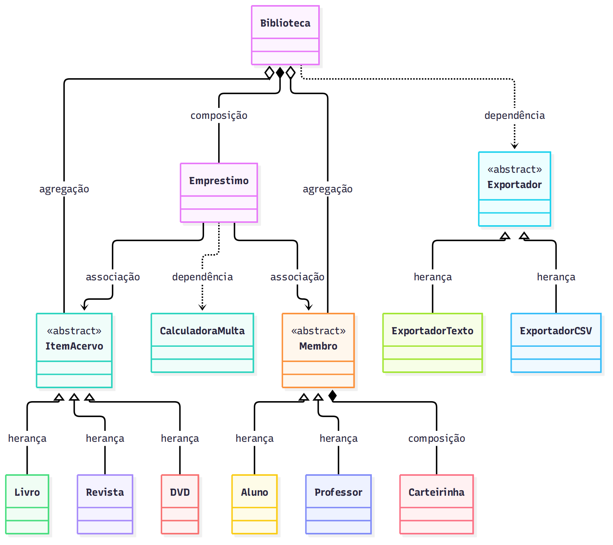
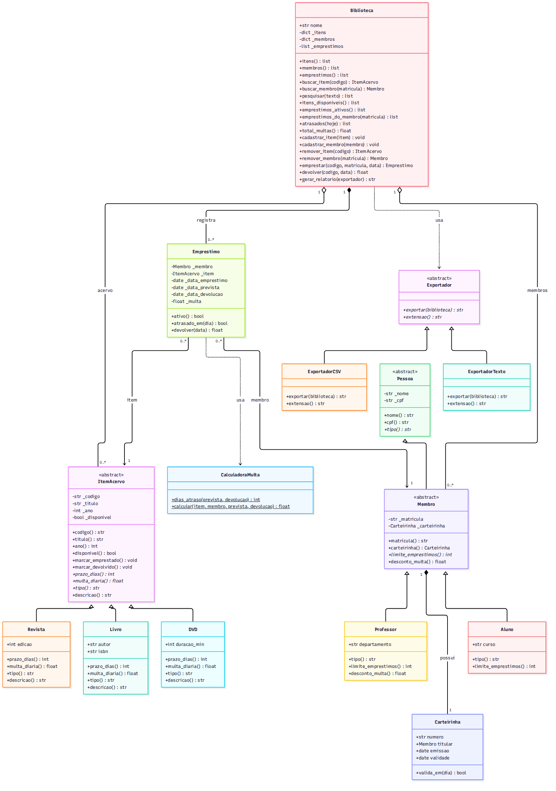
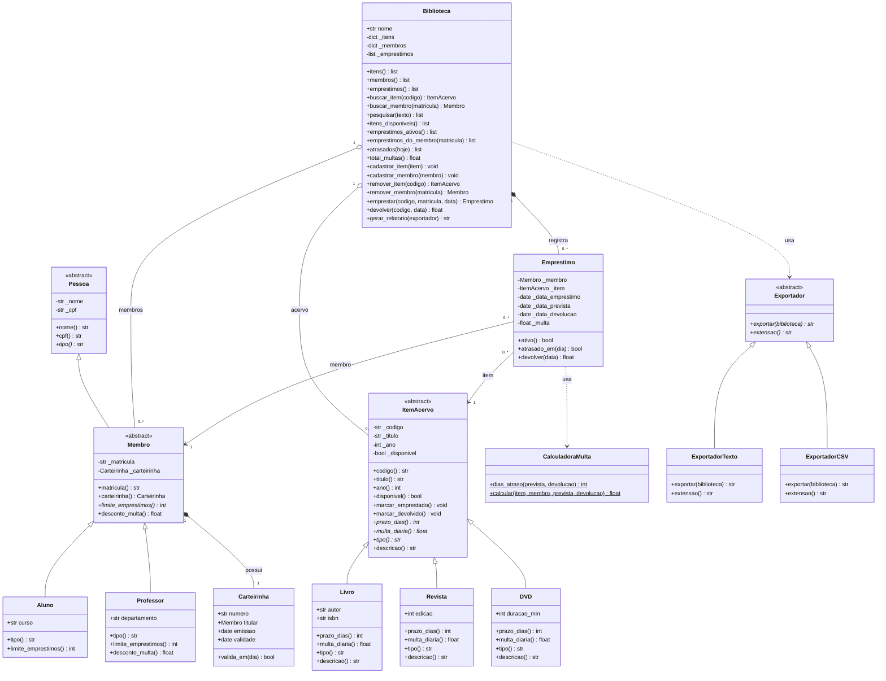
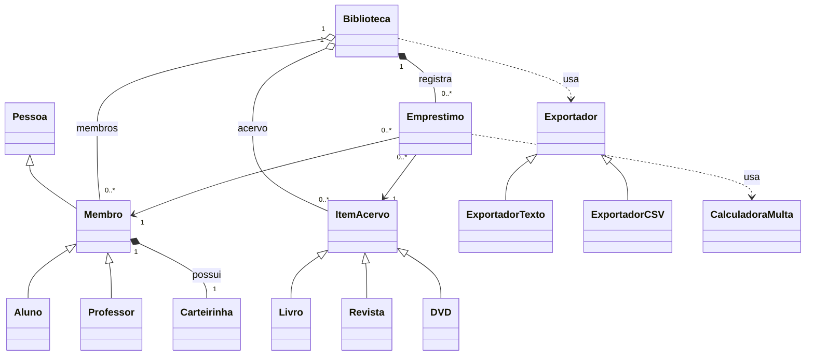

# 📚 Sistema de Biblioteca

Projeto acadêmico de **Programação Orientada a Objetos** da disciplina **Desk App I**.

**Autor:** Vinicius

Aplicação desktop em **Python 3.10+ com Tkinter** para gerenciar o acervo (livros, revistas e DVDs), os membros (alunos e professores), empréstimos, devoluções com multa e relatórios. O projeto demonstra **Herança, Polimorfismo, Composição, Agregação, Associação e Dependência**, todas cobertas por testes automatizados.

## ▶️ Como executar

Requisitos: Python 3.10 ou superior (o Tkinter já vem com o Python; no Ubuntu/Debian, se faltar: `sudo apt install python3-tk`).

```bash
git clone https://github.com/VinyCrz/sistema-biblioteca.git
cd sistema-biblioteca
python3 app.py
```

A janela abre com dados de exemplo (4 itens e 2 membros) para facilitar a demonstração.

## 🧪 Como rodar os testes

```bash
python3 -m pip install -r requirements.txt
python3 -m pytest -v
```

Em um Linux sem interface gráfica, use `xvfb-run -a python3 -m pytest -v` (sem display, os testes da interface são pulados automaticamente).

**Resultado atual: 79 testes, 100% passando.**

| Arquivo de teste | O que verifica |
|---|---|
| `test_heranca_polimorfismo.py` | `isinstance`/`issubclass`, classes abstratas, prazos/multas/tipos, `descricao()` sobrescrita, limites e descontos, exportadores, validações |
| `test_relacoes.py` | Uma seção para cada relação: composição, agregação, associação e dependência (com `unittest.mock.patch`) |
| `test_funcionalidades.py` | Cadastros, buscas, remoções, pesquisa, empréstimos, limites, devoluções, multas, atrasados, carteirinha vencida, relatórios |
| `test_interface.py` | A tela Tkinter: cadastros, erros, pesquisa, empréstimo/devolução com multa, filtro de atrasados, data inválida, relatórios |

## ✅ Funcionalidades

| Aba | Funcionalidade |
|---|---|
| Acervo | Cadastrar Livro, Revista ou DVD (o campo extra muda: Autor / Edição / Duração) |
| Acervo | Remover item selecionado |
| Acervo | Pesquisar por título, autor ou tipo (filtra enquanto digita) |
| Membros | Cadastrar Aluno ou Professor (Curso / Departamento) com carteirinha automática |
| Membros | Remover membro e ver empréstimos ativos (X/Y) |
| Empréstimos | Emprestar e devolver informando a data (vazio = hoje) |
| Empréstimos | Cálculo de multa na devolução e filtro "Mostrar só atrasados" |
| Relatório | Gerar relatório em Texto ou CSV e salvar em arquivo |

## 📏 Regras de negócio

| Tipo | Prazo | Multa por dia de atraso |
|---|---|---|
| Livro | 14 dias | R$ 1,00 |
| Revista | 7 dias | R$ 0,50 |
| DVD | 3 dias | R$ 2,00 |

| Membro | Limite de empréstimos simultâneos | Desconto na multa |
|---|---|---|
| Aluno | 3 | — |
| Professor | 10 | 50% |

- **Multa** = dias de atraso × multa diária do item × (1 − desconto do membro).
- A **carteirinha** é criada junto com o membro (`CART-0001`, `CART-0002`…) e vale **365 dias**; com ela vencida não é possível emprestar.
- **Bloqueios:** não é possível emprestar item já emprestado, passar do limite, cadastrar código/matrícula duplicados, remover item emprestado, remover membro com empréstimo ativo, devolver duas vezes ou devolver com data anterior ao empréstimo.
- Validações: código e título obrigatórios, ano inteiro ≥ 0, nome e matrícula obrigatórios, CPF com 11 dígitos (aceita pontuação).

## 🧩 Diagrama de classes (UML)

### Visão geral das relações



### Diagrama completo (atributos e métodos)



O fonte do diagrama está em [`docs/uml.mmd`](docs/uml.mmd) (Mermaid). Versão renderizada pelo GitHub:



> Para regerar a imagem `docs/uml.png`:
> `npx -y @mermaid-js/mermaid-cli -i docs/uml.mmd -o docs/uml.png -b white -s 2`

## 🔗 Relações entre classes

| Relação | Onde está no código | Notação UML |
|---|---|---|
| **Herança** | `itens.py`: `Livro`, `Revista`, `DVD` herdam de `ItemAcervo` · `pessoas.py`: `Pessoa` → `Membro` → `Aluno`/`Professor` · `relatorio.py`: `ExportadorTexto`/`ExportadorCSV` herdam de `Exportador` · `excecoes.py` | `<\|--` |
| **Polimorfismo** | `prazo_dias()`, `multa_diaria()`, `tipo()`, `descricao()` (itens); `limite_emprestimos()`, `desconto_multa()` (membros); `exportar()` (exportadores) — usados em `Biblioteca.emprestar()`, `CalculadoraMulta.calcular()` e `Biblioteca.gerar_relatorio()` | métodos abstratos `*` |
| **Composição** | `pessoas.py` → `Membro.__init__` cria `Carteirinha(self)` · `biblioteca.py` → `Biblioteca.emprestar()` cria o `Emprestimo` e o guarda em `_emprestimos` | `*--` |
| **Agregação** | `biblioteca.py` → `Biblioteca._itens` e `Biblioteca._membros` recebem objetos criados fora (sobrevivem à remoção) | `o--` |
| **Associação** | `emprestimo.py` → `Emprestimo._membro` e `Emprestimo._item` | `-->` |
| **Dependência** | `emprestimo.py` → `Emprestimo.devolver()` usa `CalculadoraMulta` · `biblioteca.py` → `gerar_relatorio(exportador)` recebe o `Exportador` por parâmetro | `..>` |

Resumo das relações:



## 📁 Estrutura de pastas

```
sistema-biblioteca/
├── app.py                  # interface gráfica Tkinter (ponto de entrada)
├── biblioteca/
│   ├── __init__.py         # exporta todas as classes
│   ├── excecoes.py         # BibliotecaError e exceções filhas
│   ├── itens.py            # ItemAcervo, Livro, Revista, DVD
│   ├── pessoas.py          # Pessoa, Carteirinha, Membro, Aluno, Professor
│   ├── multa.py            # CalculadoraMulta
│   ├── emprestimo.py       # Emprestimo
│   ├── relatorio.py        # Exportador, ExportadorTexto, ExportadorCSV
│   └── biblioteca.py       # Biblioteca (classe central)
├── tests/
│   ├── conftest.py
│   ├── test_heranca_polimorfismo.py
│   ├── test_relacoes.py
│   ├── test_funcionalidades.py
│   └── test_interface.py
├── docs/
│   ├── uml.mmd             # diagrama de classes em Mermaid
│   ├── uml.png             # diagrama completo renderizado
│   ├── uml_simples.mmd     # diagrama simplificado (apresentação)
│   └── uml_simples.png
├── README.md
├── ROTEIRO_VIDEO.md
└── requirements.txt
```
